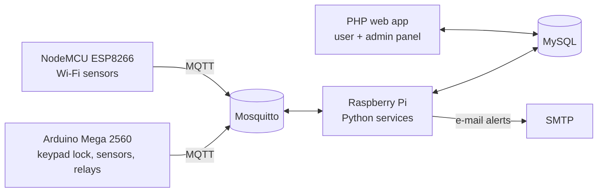

# HouseControl: a DIY smart home system

A student project that builds a complete smart home from scratch. Microcontrollers read sensors and drive actuators over **MQTT**, a **Raspberry Pi** runs the logic and stores data in **MySQL**, and a **PHP web app** lets users control devices and view reports.

🎥 A demo video is in [`Išmaniųjų_namų_sistemos_demonstravimas/`](Išmaniųjų_namų_sistemos_demonstravimas/).

## Architecture

## What's inside
| Path | Description |
|---|---|
| `Arduino_Mega2560_MQTT.ino` | Arduino Mega firmware: keypad code lock, sensors, MQTT client |
| `mqtt_nodemcu.ino` | ESP8266 (NodeMCU) firmware: Wi-Fi + MQTT sensor node |
| `Išmaniujų_namų_serverio_pusė/` | Raspberry Pi Python services: LED/lighting control, RFID door lock, smart fan, e-mail alerts, MQTT ↔ MySQL bridge (`server.py`) |
| `Išmaniųjų_namų_svetainė/` | PHP + Bootstrap web app: login/registration, device control, temperature and humidity charts, to-do and shopping lists, bills, admin panel |

## Running it
Credentials in this repo are placeholders (`YOUR_WIFI_SSID`, `YOUR_WIFI_PASSWORD`, `YOUR_DB_PASSWORD`, `YOUR_APP_PASSWORD`). Replace them with your own before flashing or deploying, and keep the real values out of git.

> This was a learning project. The PHP code builds SQL queries from user input. Use prepared statements before exposing it anywhere outside a lab network.

## Tech
C++ (Arduino) · ESP8266 · MQTT · Python · Raspberry Pi · MySQL · PHP · Bootstrap · JavaScript
